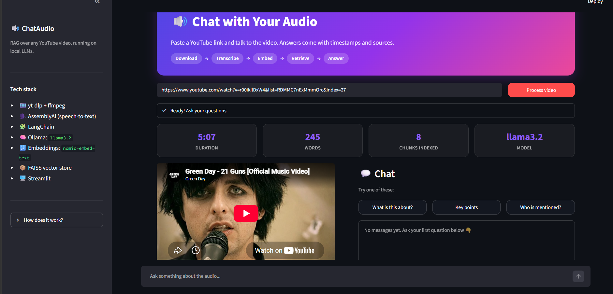
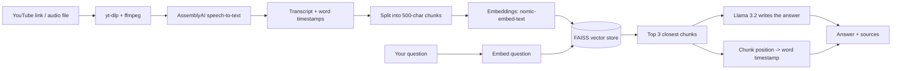

# 🔊 ChatAudio: Chat with YouTube Audio (RAG + Local LLM)

Upload an audio file or paste a YouTube link, then ask questions about it in plain English. Every answer comes with **clickable timestamps** that jump the player to the exact moment, and a **Sources used** panel that shows the transcript chunks the AI relied on.

The whole AI stack runs **locally with Ollama** (Llama 3.2), so there are no OpenAI costs and your content stays on your machine.



## ✨ Features

- **Chat with audio:** ask questions and get answers grounded in what was actually said
- **Clickable timestamps:** each answer links back to the moment in the audio or video
- **Transparent sources:** see the exact transcript chunks used for every answer
- **Auto summary:** a short summary of the audio
- **Two inputs:** YouTube link or uploaded file (mp3, wav, m4a, ogg, flac, mp4)
- **Hallucination guard:** the model is told to answer only from the retrieved text, and to say "I could not find that in the audio" otherwise
- **Runs fully local:** Llama 3.2 and embeddings via Ollama, vector search with FAISS

## 🧠 How it works (RAG pipeline)

RAG (Retrieval-Augmented Generation) lets an LLM answer questions about content it was never trained on, by looking up the relevant parts first.



1. **Get audio:** yt-dlp downloads and converts YouTube audio with ffmpeg, or you upload a file.
2. **Transcribe:** AssemblyAI returns the full text plus the start time of every word.
3. **Chunk:** the transcript is split into ~500-character overlapping pieces. Each chunk remembers its character position.
4. **Embed and index:** each chunk becomes a vector (a list of numbers capturing its meaning) and is stored in FAISS.
5. **Retrieve:** your question is embedded the same way, and FAISS returns the 3 closest chunks.
6. **Generate:** Llama 3.2 gets those chunks plus the question and writes a short answer.
7. **Timestamps:** each retrieved chunk's start position is mapped to the word spoken there, giving a time in the audio.

## 🛠️ Tech stack

| Layer | Tool |
|---|---|
| UI | Streamlit |
| Audio download | yt-dlp, ffmpeg |
| Speech-to-text | AssemblyAI |
| Orchestration | LangChain |
| LLM | Llama 3.2 via Ollama |
| Embeddings | nomic-embed-text via Ollama |
| Vector database | FAISS |

## 🚀 Getting started

### Prerequisites

- Python 3.9 or higher
- [Ollama](https://ollama.com) installed and running
- [ffmpeg](https://ffmpeg.org) installed (`winget install ffmpeg` on Windows, `brew install ffmpeg` on Mac, `sudo apt install ffmpeg` on Linux)
- A free [AssemblyAI](https://www.assemblyai.com) API key
- About 8 GB of RAM

### Installation

```bash
# 1. Clone the repo
git clone https://github.com/YOUR_USERNAME/audio-chatbot.git
cd audio-chatbot

# 2. Create and activate a virtual environment
python -m venv venv
venv\Scripts\activate          # Windows
# source venv/bin/activate     # Mac / Linux

# 3. Install dependencies
pip install -r requirements.txt

# 4. Download the local models
ollama pull llama3.2
ollama pull nomic-embed-text
```

### Configure your key

Copy `.env.example` to `.env` and add your AssemblyAI key:

```
ASSEMBLY_AI_KEY=your_assemblyai_key_here
```

Leave `GROQ_API_KEY` empty to use local Ollama (see the optional cloud mode below).

### Run

```bash
streamlit run app.py
```

Your browser opens at `http://localhost:8501`.

## 💡 Usage

1. Paste a YouTube link (or open the **Upload audio** tab) and click **Process**.
2. Wait for transcription and indexing. Short videos (1-5 minutes) are best for trying it out.
3. Read the summary, then ask questions in the chat box.
4. Click a **▶ timestamp** button to jump to that moment.
5. Open **🔍 Sources used** to see which transcript chunks produced the answer.

## 📁 Project structure

```
audio-chatbot/
├── app.py              # The whole app: pipeline, RAG logic, UI
├── requirements.txt    # Python dependencies
├── packages.txt        # System packages (ffmpeg) for cloud deployment
├── .env.example        # Template for your API keys
├── .gitignore
└── README.md
```

## 🔍 Design decisions

- **Hand-written retrieval chain.** Instead of the deprecated `RetrievalQA` helper, retrieve, augment and generate are separate, readable steps.
- **Timestamps from retrieved chunks, not from the answer text.** Matching words in the LLM's answer is unreliable because the model rephrases. Using each retrieved chunk's position in the transcript is more accurate.
- **No files shared between sessions.** Transcripts live in memory (Streamlit session state), and temp audio files get unique names and are deleted after transcription.
- **Same embedding model for indexing and querying.** Mixing models would make the vector search meaningless.

## ⚠️ Limitations

- **Small local models can hallucinate.** Llama 3.2 (3B) sometimes adds details that are not in the transcript, especially in summaries. Q&A is more reliable because answers are restricted to retrieved text.
- **Transcript quality depends on the audio.** Names and unusual words can be misheard (for example, player names in sports commentary).
- **Speed.** On an 8 GB laptop, expect roughly 10-30 seconds per answer.
- **English-focused.** Not tested on other languages.
- **YouTube downloads** are for personal and educational use and may break when YouTube changes. Update with `pip install -U yt-dlp`.

## 🔮 Future improvements

- Persist the vector store so audio does not need re-processing
- Chat memory so follow-up questions use earlier answers
- Speaker labels (diarization)
- Re-ranking retrieved chunks for better accuracy
- Evaluate answer quality on a small set of test questions

## ☁️ Optional: cloud mode

The app also supports a hosted setup. If `GROQ_API_KEY` is set (in `.env` or Streamlit Secrets), it switches to Llama 3.1 on Groq with a small built-in embedding model (FastEmbed), so it can run on Streamlit Community Cloud. Cloud servers often block YouTube downloads, so the **Upload audio** tab is the reliable input there. Free tiers have rate limits.

## 🙏 Acknowledgements

Built while learning RAG with LangChain. Thanks to the open-source communities behind Streamlit, LangChain, FAISS, yt-dlp and Ollama.

## 📄 License

MIT. See `LICENSE` if you add one to the repo.
